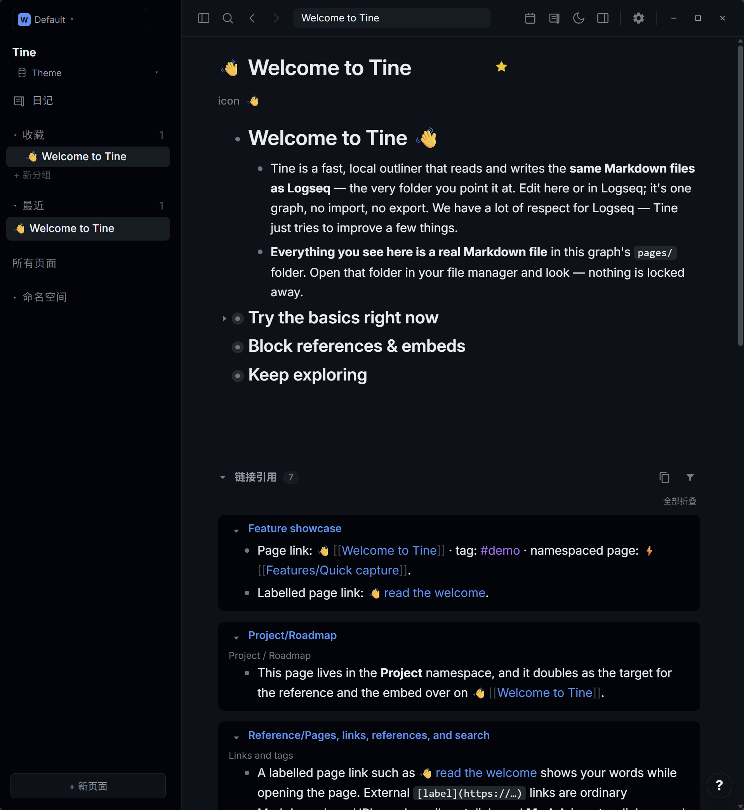
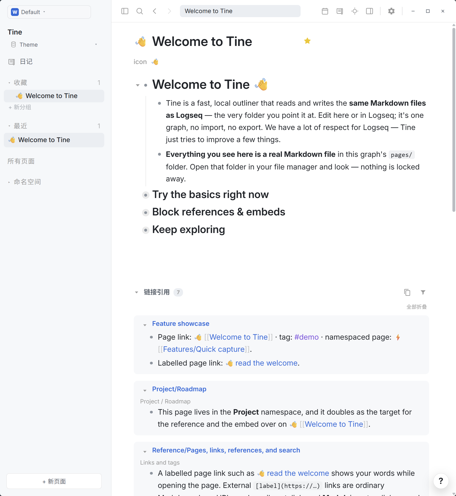

# GitHub · Prism

**White space gathers the day; a midnight page keeps the quiet. Blue paths lead thought from one line to the next.**

[Download theme.json](https://github.com/EllisMorrow/tine-theme-github-prism/releases/latest/download/theme.json) · [中文说明](README.zh-CN.md) · [Adaptation notes](docs/adaptation.md)

GitHub Light Default and Dark Default meet in one Tine theme, pairing familiar clear pages and deep charcoal surfaces with measured blue accents.

### Dark mode

### Light mode

*Actual Windows Tine screenshots supplied after testing. Both palettes are included in this package.*

## Install

1. Download [theme.json](https://github.com/EllisMorrow/tine-theme-github-prism/releases/latest/download/theme.json).
2. In Tine, open **Settings → Appearance → Theme packages → Select theme.json** and select the downloaded file.
3. Choose **Use colors**, then select **Light**, **Dark** or **System** mode.

Requires Tine Theme API **0.2** support. Existing `logseq/custom.css` and device accent settings may affect the result. This package supplies colors only; typography, layout, task markers and other roles outside the theme API remain host-controlled.

## Palette

| Role | Light | Dark |
| --- | --- | --- |
| Canvas | `#ffffff` | `#0d1117` |
| Sidebar | `#f6f8fa` | `#010409` |
| Body | `#1f2328` | `#e6edf3` |
| Heading | `#1f2328` | `#e6edf3` |
| Accent | `#0969da` | `#4493f8` |
| Links | `#0969da` | `#4493f8` |
| Tags | `#8250df` | `#a371f7` |
| Mark background | `#fff8c5` | `#3d3420` |

## Tested in Tine

The manifest passed the official theme checker. A Chromium fixture checked both complete token sets, mode switching and specified contrast pairs. The user supplied the real Windows light/dark screenshots above using Tine's public welcome graph. The visible headings, body, outlines, links, tags, inline code and reference panels are shown; mark highlights, selection behavior, Settings and other platforms are not established by these images. See [screenshot notes](docs/screenshots.md).

## Source and scope

Based on [GitHub Light Default / GitHub Dark Default](https://github.com/primer/github-vscode-theme) at `cd78e5e4e7bcf132a6f428ae0f32264bb1b729cf`, under MIT; see [LICENSE](LICENSE). Based on GitHub Primer’s official GitHub VS Code theme repository at fixed revision cd78e5e4e7bcf132a6f428ae0f32264bb1b729cf; the upstream repository provides both light and dark themes. The Tine role mapping is an independent adaptation.

Independent community adaptation by **EllisMorrow**, developed with AI assistance (`aiDevelopment: primary`). No Codex program code, logo or bundled assets are included. No affiliation or endorsement is claimed.

Only the 21 supported literal color roles per mode are packaged. It does not claim pixel-for-pixel reproduction of Codex, or that all Tine-derived and opacity-dimmed text meets a contrast target. Check results and actual application coverage are recorded in [adaptation notes](docs/adaptation.md).

## Feedback

[Open an issue](https://github.com/EllisMorrow/tine-theme-github-prism/issues) with your Tine version, operating system, mode and a screenshot without private note content. The download badge counts GitHub Release asset downloads, not installations or unique users.
